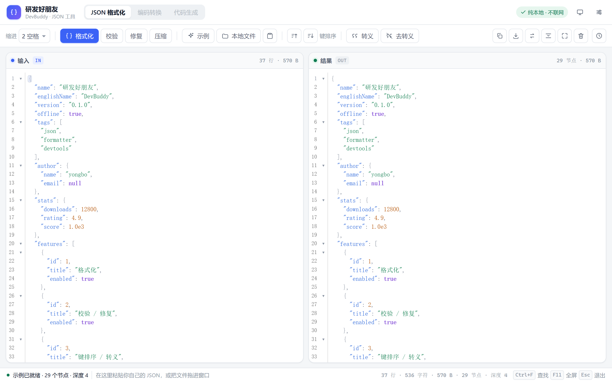
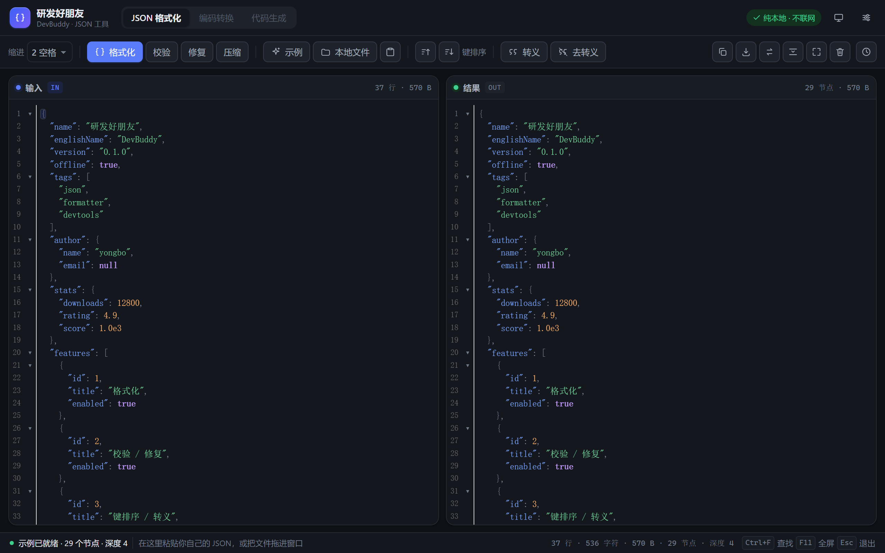
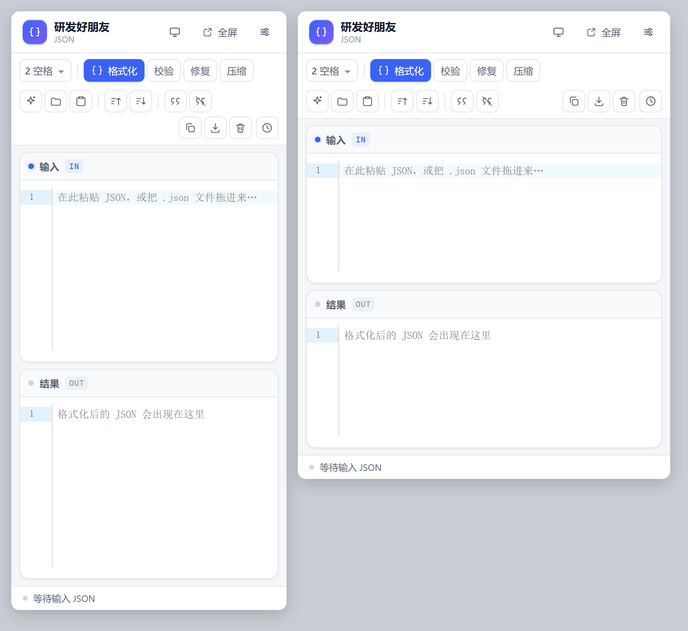

# 研发好朋友 · DevBuddy

离线可用的开发者工具箱浏览器扩展（Chrome / Edge，Manifest V3）。
第一个模块 1:1 复刻了 [锤子在线工具 - JSON 格式化](https://www.toolhelper.cn/JSON/JSONFormat)，并在原站基础上补齐了错误定位、历史记录、暗色主题与三套入口。

**核心原则：数据不出本机。** 不联网、不上传、不登录，`host_permissions` 为空，所有解析/格式化/修复都在本地完成。



## 功能

**复刻原站**

- 双栏编辑器：行号、JSON 语法高亮、括号匹配、代码折叠、当前行高亮
- 格式化：缩进 2 空格 / 4 空格 / Tab，保留键顺序与数字字面量（`1.0`、`1e3` 不会被改写）
- 压缩：一键转单行
- 校验：语法错误给「第 N 行第 M 列 + 中文原因 + 修复建议」，编辑器内高亮并可一键定位
- 修复：注释、尾逗号、单引号、无引号键、全角标点、BOM、`True/None/undefined/NaN`、前导零、`+1`、字符串内裸换行、前后包裹的代码，修完列出改动清单
- 键排序：升序 / 降序，递归所有层级
- 转义 / 去转义
- 示例、本地文件（点击选择 / 拖拽 / 剪贴板）、复制、下载、全屏、折叠、清空
- 查找 `Ctrl+F`、常驻查找 `Alt+F`（Enter 下一个，Shift+Enter 上一个）
- 实时统计：行数、字符、字节、节点数、层级深度

**额外增强**

- 错误横幅：中文报错 + 提示 + 「定位到错误」/「尝试修复」两个按钮
- 本地历史：最近 20 条，可置顶恢复、清空（`chrome.storage.local`）
- 三套入口：扩展弹窗、独立全屏标签页、侧边栏（同一套组件，自适应布局）
- 亮 / 暗 / 跟随系统三态主题，字号 11–18px，自动换行开关
- 沉浸模式：`F11` 隐藏顶栏专注编辑，`Esc` 退出



## 安装（开发者模式）

```bash
npm install
npm run build      # 类型检查 + 构建到 dist/
```

1. 打开 `chrome://extensions`（Edge 为 `edge://extensions`）
2. 右上角打开「开发者模式」
3. 点「加载已解压的扩展程序」，选择本项目的 `dist/` 目录
4. 点扩展图标即用；侧边栏从浏览器的侧栏入口打开，或按 `Alt+Shift+K`

`Alt+Shift+J` 直接在新标签页打开全屏版。

## 开发

```bash
npm run dev        # 监听构建，产物仍在 dist/（改动后到扩展页点刷新）
npm test           # 核心引擎单元测试（44 个用例）
npm run smoke      # 无头浏览器 UI 冒烟测试（模拟粘贴 + 点按钮，16 项断言）
npm run typecheck
```

## 结构

```
src/
├─ core/json/          纯函数引擎，零 DOM / 零 chrome API，可单测
│  ├─ parser.ts        手写递归下降解析器：AST 保留原始字面量 + 中文错误定位
│  ├─ serialize.ts     序列化 / 缩进 / 压缩 / 键排序
│  ├─ repair.ts        容错修复流水线（逐类计数，可解释）
│  ├─ escape.ts        转义 / 反转义
│  └─ stat.ts          节点数 / 深度 / 类型分布
├─ ui/                 Vue 3 视图层，只做「薄壳」
│  ├─ pages/JsonTool.vue      主页面与全部动作编排
│  ├─ components/EdPane.vue   CodeMirror 6 封装（受控、错误行标注、只读）
│  └─ styles/base.css         设计 token（亮/暗）+ CodeMirror 主题
├─ background/         右键/命令入口、侧边栏唤起
└─ shared/             chrome.storage 封装（普通网页自动退回 localStorage）
```

设计上刻意把「引擎」和「界面」切开：`core` 里全是 `string → string | Result` 的纯函数，
将来要搬去做 CLI 或网站，直接复用，不用重写逻辑。

## 边界

- 不做登录、云同步、分享链接；扩展不发起任何网络请求。
- 不做 AI 能力；如需，可后续加「自带 Key（BYOK）」入口，默认关闭。
- 系统级全局快捷键、读写任意磁盘路径、托盘常驻等需本地原生程序，扩展做不了。

功能可行性矩阵（可做 / 需服务端 / 做不了 / 可能收费）见 [docs/FEATURES.md](docs/FEATURES.md)，
任务拆解与里程碑见 [docs/PLAN.md](docs/PLAN.md)。


