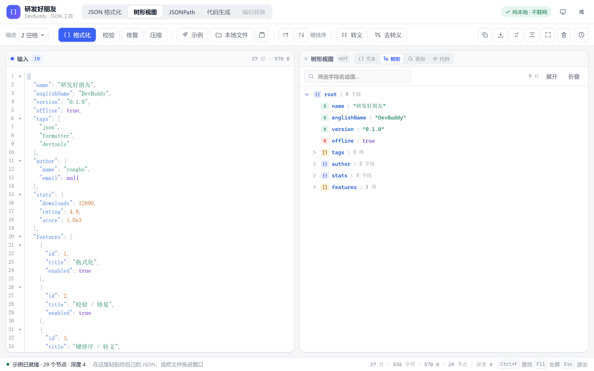
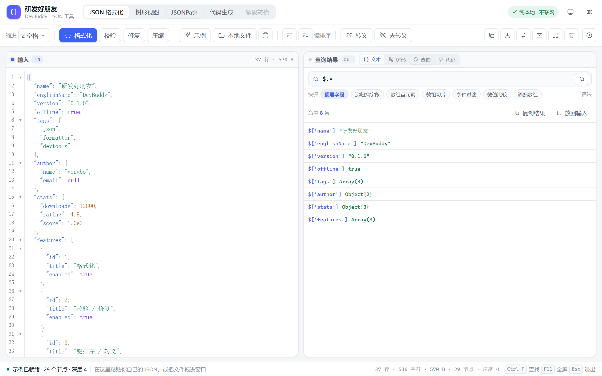
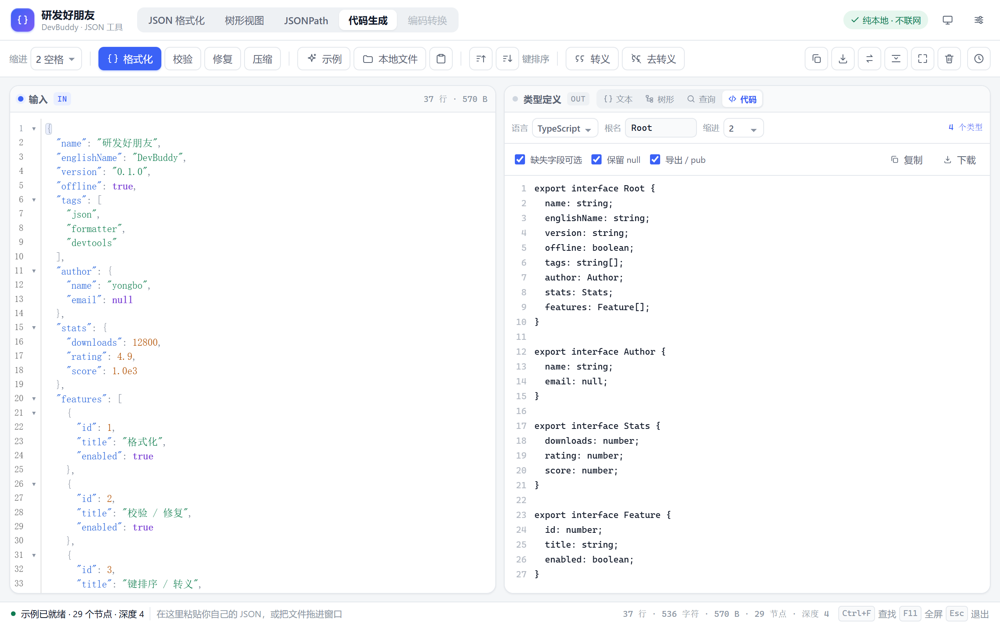
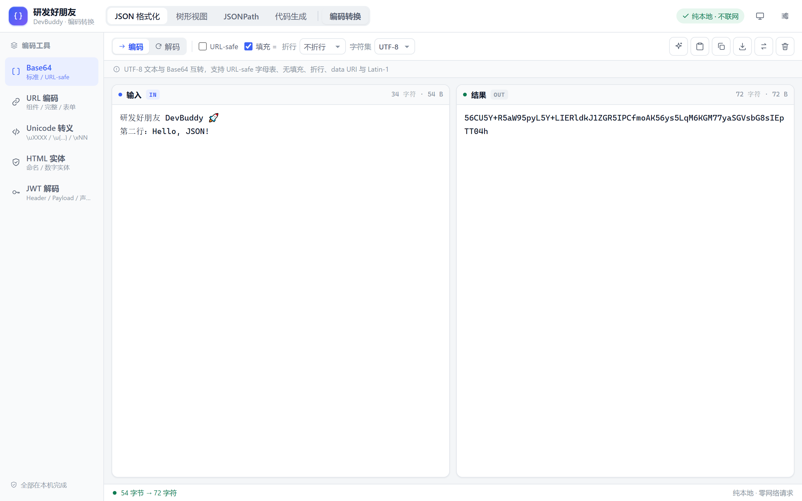
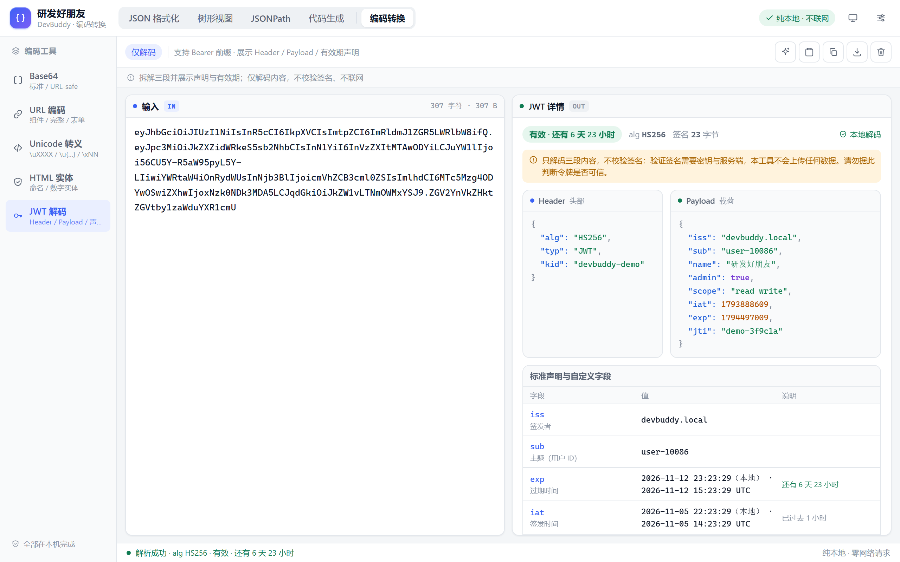
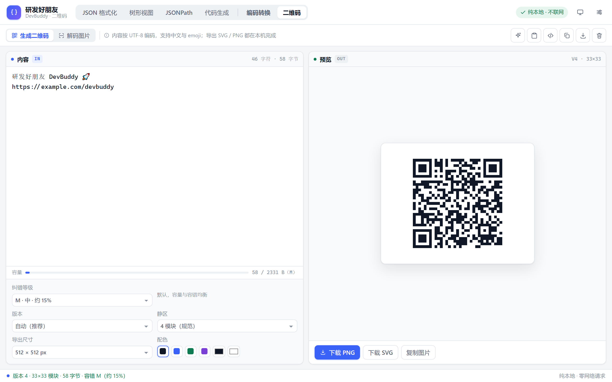
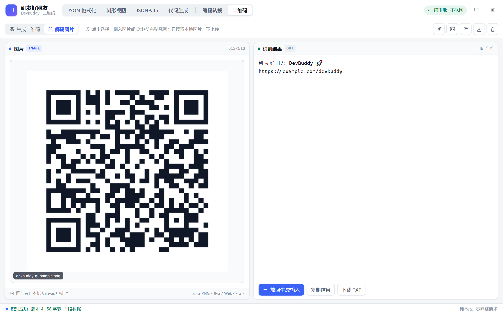
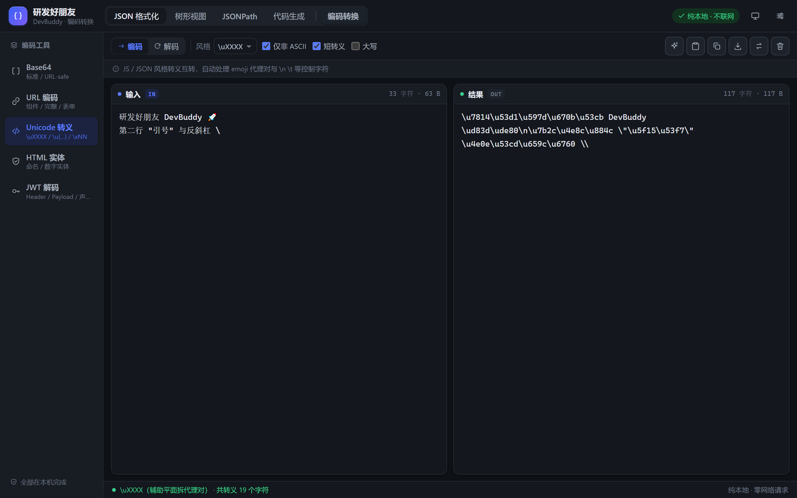
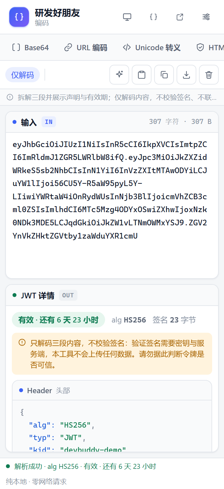
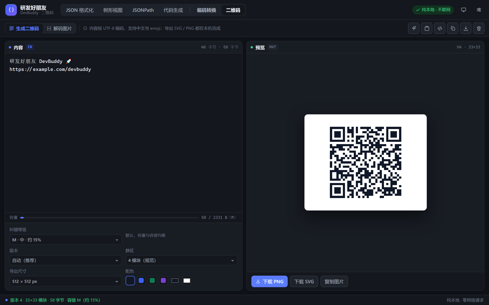

# 研发好朋友 · DevBuddy

离线可用的开发者工具箱浏览器扩展（Chrome / Edge，Manifest V3）。
第一个模块 1:1 复刻了 [锤子在线工具 - JSON 格式化](https://www.toolhelper.cn/JSON/JSONFormat)，并在原站基础上补齐了错误定位、历史记录、暗色主题与三套入口；第二个模块是纯本地的编码转换（Base64 / URL / Unicode / HTML 实体 / JWT）；第三个模块是二维码生成与解码。顶栏可在三个模块间切换，各自的输入互不干扰。

**核心原则：数据不出本机。** 不联网、不上传、不登录，`host_permissions` 为空，所有解析/格式化/修复都在本地完成。


## 功能

**复刻原站**

- 双栏编辑器：行号、JSON 语法高亮、括号匹配、代码折叠、当前行高亮
- 格式化：缩进 2 空格 / 4 空格 / Tab，保留键顺序与数字字面量（`1.0`、`1e3` 不会被改写）
- 压缩：一键转单行
- 校验：语法错误给「第 N 行第 M 列 + 中文原因 + 修复建议」，编辑器内高亮并可一键定位
- 修复：注释、尾逗号、单引号、无引号键、全角标点、BOM、`True/None/undefined/NaN`、前导零、`+1`、字符串内裸换行、前后包裹的代码，修完列出改动清单
- 键排序：升序 / 降序，递归所有层级
- 转义 / 去转义
- 示例、本地文件（点击选择 / 拖拽 / 剪贴板）、复制、下载、全屏、折叠、清空
- 查找 `Ctrl+F`、常驻查找 `Alt+F`（Enter 下一个，Shift+Enter 上一个）
- 实时统计：行数、字符、字节、节点数、层级深度

**第二阶段增强（输出区四个视图，顶栏可直接切换）**

- **树形视图**：按 AST 渲染，可逐层折叠/展开全部、按字段名或值筛选、类型徽标（对象/数组/字符串/数字/布尔/null）、复制规范化 JSONPath、点击「定位」跳回输入源码对应字符
- **JSONPath 查询**：零依赖自研引擎（MV3 禁 eval），支持 `$.a.b` / `$..title` / `[*]` / `[0,-1]` / `[1:5:2]` / `[0,'k']` / `[?(@.price < 10 && @.isbn)]` / `=~ /^A/`，括号分组与 `&& || !`；中文语法错误 + 位置提示，结果可复制或放回输入
- **代码生成**：从值反推结构（数组内对象合并、缺失字段可选、null 联合），生成 TypeScript / Go / Java / Python / Rust 五种定义；可改根名、缩进、导出、可选字段、`omitempty`、null 处理，支持复制与下载
- 三个视图共用同一份输入，切换不丢数据；顶栏 tab 与输出区 tab 双向联动，弹窗/侧边栏同样可用







**编码转换（第二阶段第二批 · B8）**

- **Base64 / Base64URL**：UTF-8 与 Latin-1 双字符集、URL-safe 字母表、去填充、按 64/76/100 字符折行、严格校验；解码自动识别折行、`data:` URI 前缀与 BOM，非 UTF-8 字节降级 Latin-1 并给出警告
- **URL 编码**：组件 / 完整 URL / 表单（空格 → `+`）/ 路径四种模式，严格 RFC 3986、按行批量；非法 `%` 转义报出具体位置
- **Unicode 转义**：`\uXXXX` / `\u{…}` / `\xNN` 三种风格，自动拆分与合并 emoji 代理对，支持 `\n \t \\` 等短转义、大小写与「仅非 ASCII」
- **HTML 实体**：命名实体 + 十进制/十六进制数字实体，按 HTML5 规则处理 Windows-1252 区段与越界码点，编码强度三档
- **JWT 解码**：Header / Payload 卡片带语法着色，标准声明中文化并换算本地时间、UTC 与剩余时长，判定生效/过期；**只解码内容，不校验签名**（界面显著提示，需密钥与服务端才能验签）
- 五类工具均实时转换，支持方向切换、示例、粘贴、复制、下载、结果放回输入（`Ctrl+Enter`）；切换工具会保留用户输入





**二维码生成 / 解码（第三阶段 · 新增）**

- **生成**：文本按 UTF-8 写入 Byte 模式，中文与 emoji 不乱码；纠错等级 L/M/Q/H、版本自动或固定 1–40、静区 0/2/4/8 模块、前景/背景色与四组配色预设、导出尺寸 256–2048px；实时预览矢量 SVG，可下载 PNG / SVG、复制 SVG 源码或复制 PNG 图片
- **解码**：点击选择、拖入或 `Ctrl+V` 粘贴本地图片，Canvas 取像素后交给 jsQR 识别，自动尝试反色二维码，按 UTF-8 还原字节内容，显示版本 / 字节数 / 数据段；支持 PNG / JPG / WebP / GIF，图片只在本机处理
- **联动**：解码结果一键「放回生成输入」；内置「载入示例二维码」生成真实 PNG 并走完整解码链路，方便自测
- 容量条实时显示已用字节 / 当前纠错等级上限，超限给中文提示与可操作建议；静区不足会提示扫码风险





**额外增强**

- 错误横幅：中文报错 + 提示 + 「定位到错误」/「尝试修复」两个按钮
- 本地历史：最近 20 条，可置顶恢复、清空（`chrome.storage.local`）
- 三套入口：扩展弹窗、独立全屏标签页、侧边栏（同一套组件，自适应布局）
- 亮 / 暗 / 跟随系统三态主题，字号 11–18px，自动换行开关
- 沉浸模式：`F11` 隐藏顶栏专注编辑，`Esc` 退出


## 安装（开发者模式）

```bash
npm install
npm run build      # 类型检查 + 构建到 dist/，并生成根目录转发版 manifest
```

构建完成后这两个目录**都能**加载：

| 选哪个 | 说明 |
|---|---|
| **`D:\Personal\devbuddy\dist`** | 产物目录，最直接、加载最快（推荐） |
| **`D:\Personal\devbuddy`** | 项目根目录，`manifest.json` 会转发到 `dist/` 下的真实入口 |

根目录的 `manifest.json` 是**构建时自动生成**的（已 gitignore，不要手改），内容就是把 `popup.html` / `sidepanel.html` / `background.js` / `icons` 等路径统一加上 `dist/` 前缀。删掉 `dist` 后根目录会加载失败，重新 `npm run build` 即可恢复。根目录加载时 Chrome 会连 `node_modules` 一起扫描，首次加载略慢，功能完全一致。

1. 打开 `chrome://extensions`（Edge 为 `edge://extensions`）
2. 右上角打开「开发者模式」
3. 点「加载已解压的扩展程序」，选择上面任一个目录
4. 点扩展图标即用；侧边栏从浏览器的侧栏入口打开，或按 `Alt+Shift+K`

`Alt+Shift+J` 直接在新标签页打开全屏版（两种加载方式都会正确跳到 `dist/index.html`）。

后续改了代码：`npm run build` → 回到扩展页点刷新按钮，不需要重新「加载」。

## 开发

```bash
npm run dev              # 监听构建，产物仍在 dist/（改动后到扩展页点刷新）
npm test                 # 核心引擎单元测试（150 个用例）
npm run smoke            # 主流程 UI 冒烟（16 项断言）
npm run smoke:views      # 增强视图 UI 冒烟（15 项断言）
npm run smoke:encoding   # 编码工具 UI 冒烟（39 项断言，含 340px 紧凑模式）
npm run smoke:qr         # 二维码 UI 冒烟（34 项断言，CDP 真实时间跑图片解码往返）
npm run smoke:all        # 四套冒烟一起跑
npm run shot:views       # 生成 JSON 视图截图到 .shots/
npm run shot:encoding    # 生成编码模块亮/暗与三入口截图
npm run shot:qr          # 生成二维码模块亮/暗与三入口截图（CDP 精确锁定 1280/460/340）
npm run verify:qr-ext    # 真实扩展环境验证（CDP 加载根目录与 dist/，检查三入口与解码）
npm run typecheck
```

`tests/` 下按模块拆：`json.test.ts` 解析器与格式化、`query.test.ts` JSONPath、`codegen.test.ts` 类型推断与五语言输出、`encoding.test.ts` 五类编解码与 JWT 时间判定（54 个用例）、`qrcode.test.ts` 二维码生成/渲染/解码往返（17 个用例）。`core/` 全是纯函数，不依赖 DOM 与 chrome API；二维码的图片读取放在 `ui/composables/useQrImage.ts`。

## 结构

```
src/
├─ core/json/          纯函数引擎，零 DOM / 零 chrome API，可单测
│  ├─ parser.ts        手写递归下降解析器：AST 保留原始字面量 + 中文错误定位
│  ├─ serialize.ts     序列化 / 缩进 / 压缩 / 键排序
│  ├─ repair.ts        容错修复流水线（逐类计数，可解释）
│  ├─ escape.ts        转义 / 反转义
│  ├─ stat.ts          节点数 / 深度 / 类型分布
│  └─ value.ts         AST → 普通 JS 值（树/查询/代码生成共用）
├─ core/query/jsonpath.ts  自研 JSONPath：选择器 + 过滤表达式递归下降，不用 eval
├─ core/codegen/       infer.ts 结构推断 + emit.ts 五语言渲染
├─ core/encoding/      B8 编码引擎（纯函数）
│  ├─ base64.ts        字节级编解码、URL-safe、data URI、UTF-8 校验
│  ├─ url.ts           四种 URL 模式 + 按行批量 + 中文错误定位
│  ├─ unicode.ts       \uXXXX / \u{…} / \xNN 与代理对
│  ├─ html.ts          命名 / 数字实体，不依赖 DOM
│  ├─ jwt.ts           三段解码、声明中文化与有效期判定（不验签）
│  └─ index.ts         工具元数据 + runEncoding 统一分发
├─ core/qrcode/        二维码引擎（纯函数；qrcode-generator / jsqr 均本地打包）
│  ├─ generate.ts      UTF-8 字节写入 Byte 模式、自动版本、纠错与容量
│  ├─ render.ts        SVG 路径合并、颜色白名单、RGBA 矩阵
│  ├─ decode.ts        jsQR RGBA 解码、UTF-8 字节还原、反色尝试
│  └─ index.ts         统一入口与配色 / 尺寸元数据
├─ ui/                 Vue 3 视图层，只做「薄壳」
│  ├─ pages/JsonTool.vue          JSON 主页面与全部动作编排
│  ├─ pages/EncodingTool.vue      编码转换页面（五工具、方向、动态选项）
│  ├─ pages/QrTool.vue            二维码页面（生成 / 解码双 tab）
│  ├─ components/EdPane.vue       CodeMirror 6 封装（受控、错误行标注、按字符定位）
│  ├─ components/TreeView.vue     树形视图
│  ├─ components/QueryPanel.vue   JSONPath 查询
│  ├─ components/CodegenPanel.vue 代码生成
│  ├─ components/JwtResult.vue    JWT 三段结构化展示
│  ├─ composables/useQrImage.ts   图片 → Canvas → RGBA、PNG / 示例图导出
│  └─ styles/base.css             设计 token（亮/暗）+ CodeMirror 主题
├─ background/         右键/命令入口、侧边栏唤起
└─ shared/             chrome.storage 封装、pageUrl（兼容两种加载位置）、views（视图定义）
```

入口地址不写死：`pageUrl()` 读 `manifest.action.default_popup` 推断前缀，所以「加载 `dist/`」与「加载根目录」两种方式下，弹窗、全屏页、侧边栏都能各自找对文件。

设计上刻意把「引擎」和「界面」切开：`core` 里全是 `string → string | Result` 的纯函数，
将来要搬去做 CLI 或网站，直接复用，不用重写逻辑。

## 边界

- 不做登录、云同步、分享链接；扩展不发起任何网络请求。
- 不做 AI 能力；如需，可后续加「自带 Key（BYOK）」入口，默认关闭。
- 编码转换里的 JWT **只解码、不验签**；验证签名需要密钥与服务端，本扩展刻意不碰。
- 二维码只解码用户主动选择/拖入/粘贴的本地图片，不调用摄像头、不截屏、不申请额外权限；倾斜过大、反光或非 UTF-8 编码的二维码可能识别失败。
- 第二阶段尚未覆盖：JSON↔YAML/XML/CSV/TOML、JSON Diff、时间戳识别、页面取词、Mock 生成、多语言界面，排在后续批次。
- 系统级全局快捷键、读写任意磁盘路径、托盘常驻等需本地原生程序，扩展做不了。

功能可行性矩阵（可做 / 需服务端 / 做不了 / 可能收费）见 [docs/FEATURES.md](docs/FEATURES.md)，
任务拆解与里程碑见 [docs/PLAN.md](docs/PLAN.md)。









